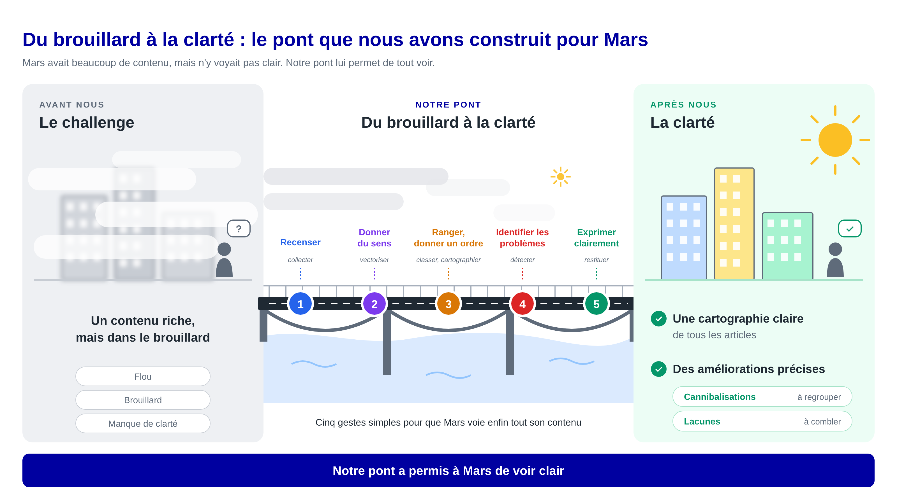
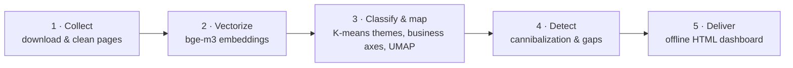

# Semantic Content Mapping — detecting cannibalization and content gaps with embeddings

> **From fog to clarity:** turn hundreds of articles into a clear semantic map, find the articles that compete with each other, and the topics nobody covers.

*Case proposed by **Mars Information Services France** (Mars group) during the **Alsace Tech AI Autumn School**, 26–29 October 2026.*
🇫🇷 [Résumé en français](#résumé-en-français)

---

## The problem

A content team publishing pet-care advice across several brands relies on **keyword analysis**. Keywords show which terms appear, but not what articles *mean*:

- **Cannibalization** — two articles from sister brands answer the same reader question and split the audience.
- **Content gaps** — some reader needs are covered by no article at all.
- **No overview** — editorial decisions are made case by case, after the fact.

## The solution

A pipeline that reads every article, represents its **meaning** as a vector, and builds a map of the whole portfolio.





| Step | What it does | Why it matters |
|---|---|---|
| 1. Collect | Download pages, extract the main text (trafilatura), remove text repeated across a brand's pages (menus, banners, CTAs) | Shared boilerplate would make every article of a brand look alike |
| 2. Vectorize | `BAAI/bge-m3` (multilingual, 1,024 dims, up to 8,192 tokens) for articles **and** ~200-word passages | Compares meaning, not words; passages prove duplicated content |
| 3. Classify & map | K-means themes named by meaning (c-TF-IDF candidates + embedding-based selection), business axes (species × food type × life stage × health), UMAP map with trustworthiness | One structure from the article to the theme to the business family |
| 4. Detect | Cross-brand pairs above a similarity threshold, complete-linkage groups, paragraph overlap; gap grid with a brand-scope rule | Actionable lists: what to merge, what to write |
| 5. Deliver | A single self-contained HTML dashboard (FR/EN): map, cannibalization matrix, gap grid, live threshold slider | Usable by non-technical teams, offline |

## Results on the real case (aggregated)

| | |
|---|---|
| Brands / articles | 5 brands · 658 English articles (+4 Spanish = 662 classified) · 2,961 passages |
| Themes | 15 K-means themes in 6 business families · UMAP trustworthiness 0.928 |
| Cannibalization | Similarity threshold ≈ 0.82 (0.816 maximised F1 = 0.90 on 65 hand-labelled pairs) → 219 cross-brand pairs in 51 groups |
| Content gaps | 4 portfolio-wide gaps, 8 thin-coverage cells, 12 brand-level gaps |

> The source data (URLs, texts, embeddings) belong to Mars and are **not published**. See [`data/README.md`](data/README.md).

## Repository structure

```
semantic-content-mapping/
├── notebooks/
│   ├── mars_carte_urls.ipynb     # POC: list of URLs → cleaned corpus → embeddings → themes → interactive map
│   ├── mars_pipeline_v2.ipynb    # Full analysis: themes, business axes, cannibalization, gaps, dashboard
│   └── README.md                 # Which notebook to run, inputs, outputs, runtime
├── docs/
│   ├── ADAPTER.md                # 🔧 What to change to reuse the code on your own content (FR)
│   └── METHODOLOGY.md            # Methodological choices and their justification
├── data/README.md                # Expected input formats (data not included)
├── outputs/                      # Generated files (git-ignored)
├── requirements.txt
└── LICENSE
```

## Quick start

**Google Colab (recommended, GPU T4):** open a notebook, upload your input files to `/content`, then *Runtime → Run all*. Paths are detected automatically (Colab or local).

**Local:**
```bash
python -m venv .venv && source .venv/bin/activate   # Windows: .venv\Scripts\activate
pip install -r requirements.txt
jupyter lab notebooks/
```
Put your input files in `data/`; results are written to `outputs/`.

| Notebook | Input | Main output |
|---|---|---|
| `mars_carte_urls.ipynb` | Excel of URLs (one sheet per brand) or CSV with `url, titre, texte` | `outputs/carte_urls/carte_urls.html` |
| `mars_pipeline_v2.ipynb` | Step 1 and step 2 archives (cleaned corpus + embeddings) | `outputs/mars_tableau_de_bord.html` + delivery zip |

➡️ **To reuse the code on another domain** (other brands, other families, other business axes, other paths), follow [`docs/ADAPTER.md`](docs/ADAPTER.md).

## Tech stack

Python · pandas · NumPy · scikit-learn (K-means, silhouette) · SciPy (complete linkage, convex hulls) · sentence-transformers / PyTorch (`BAAI/bge-m3`) · umap-learn · trafilatura · BeautifulSoup · Plotly.js · vanilla JS/SVG dashboard · Google Colab

## Roadmap

- [ ] One function per pipeline step (`collect()`, `clean()`, `embed()`, `classify()`, `detect()`, `render_dashboard()`), called in sequence
- [ ] Single entry point: Excel → dashboard, without intermediate archives
- [ ] Gradio interface (upload an Excel file, get the dashboard) and a public demo on Hugging Face Spaces
- [ ] Fictional demo dataset
- [ ] Configuration file for business families and axes
- [ ] Smoke tests

## Limits

- K is fixed by hand: no k reached strict stability (ARI ≥ 0.80); themes overlap.
- A 2D map distorts distances: an empty area is **not** a content gap (gaps come from the classification grid).
- The threshold and labels were validated on small hand-labelled samples (65 pairs, 80 articles).
- High similarity does not prove identical search intent: results are leads to review, not verdicts.

## Responsible use

Respect the terms of use and `robots.txt` of the sites you collect, keep request rates low, and prefer an export from your CMS when available.

## My role

<!-- To fill in: what you personally designed, coded and decided. -->

## Acknowledgements

Mars Information Services France (tutor: Nicolas Arbona Casado, Sr. Lead Analytics & Performance) and Alsace Tech for the AI Autumn School.

## License

MIT — see [`LICENSE`](LICENSE).

---

## Résumé en français

**Cartographie sémantique pour l'optimisation de la stratégie de contenu.** Projet réalisé lors de l'École d'automne de l'IA d'Alsace Tech (26–29 octobre 2026), sur un cas proposé par Mars Information Services France.

Le pipeline lit chaque article, en calcule le sens (bge-m3), regroupe les articles en thèmes, les étiquette selon les axes métier (espèce, type d'aliment, stade de vie, santé), puis repère **la cannibalisation entre marques** et **les sujets non couverts**. Le résultat est un tableau de bord HTML autonome.

- Les notebooks sont commentés en français : [`notebooks/README.md`](notebooks/README.md)
- Pour adapter le code à votre propre contenu : [`docs/ADAPTER.md`](docs/ADAPTER.md)
- Les données Mars ne sont pas publiées.
